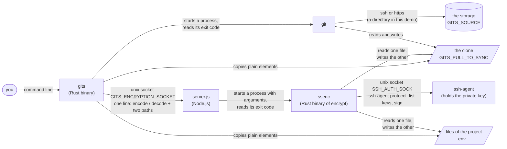
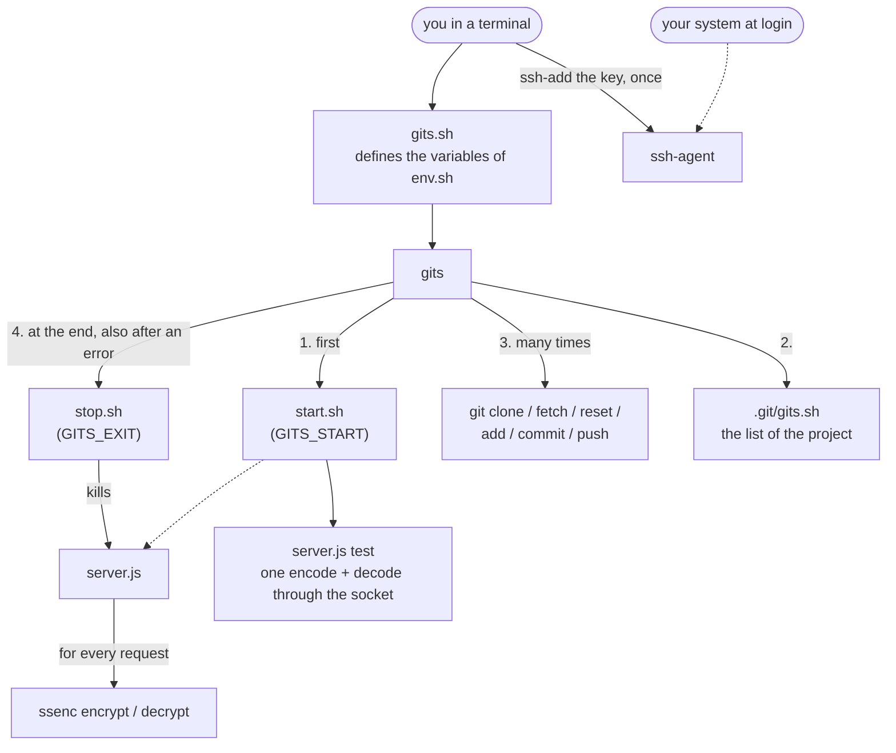
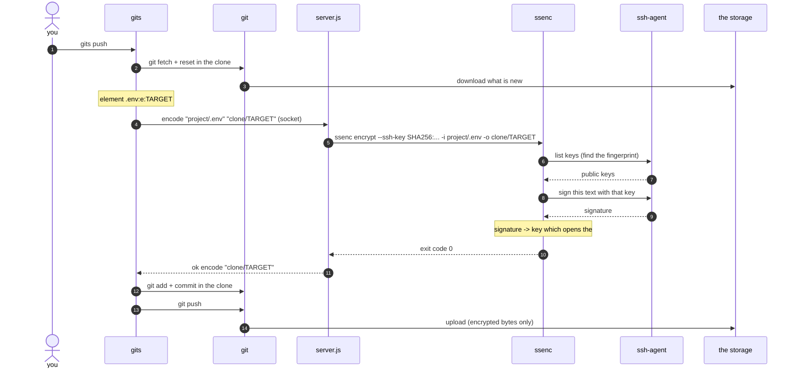
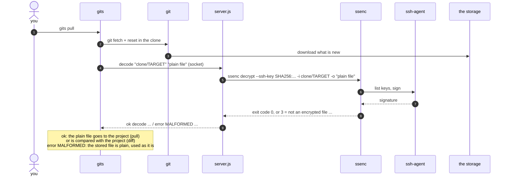

# How gits works with encrypt: the components

What takes part in a normal `gits push` / `gits pull` / `gits diff` of this demo
([ENCRYPT_PROCESS.md](ENCRYPT_PROCESS.md)) when a file is registered as encrypted
(`SOURCE:e:TARGET`), who talks to whom, and who starts whom.

The question behind it, whether so many components are needed, is answered in
[RUST_SERVER.md](RUST_SERVER.md).

## The components

| #   | component                        | what it is                                                        | who starts it                                         | how long it lives           |
| --- | -------------------------------- | ----------------------------------------------------------------- | ----------------------------------------------------- | --------------------------- |
| 1   | `gits`                           | the Rust binary of this repository                                | you (here through the wrapper `gits.sh`)              | one command                 |
| 2   | `git`                            | your normal git                                                   | gits, many times in one command                       | one git command             |
| 3   | the storage (`GITS_SOURCE`)      | a git repository: a directory here, GitHub in real use            | nobody, it is just there                              | always                      |
| 4   | the clone (`GITS_PULL_TO_SYNC`)  | a clone of the storage on this machine, the place gits works in   | gits (`git clone`, later `git fetch`)                 | kept between commands       |
| 5   | the server (`server.js`)         | Node.js process listening on the unix socket                      | `start.sh`, which gits runs as `GITS_START`           | one gits command (`GITS_EXIT` runs `stop.sh`) |
| 6   | `ssenc`                          | the Rust binary of the encrypt repository, it does the encryption | the server, once for every file                       | one file                    |
| 7   | `ssh-agent`                      | the agent of your system, it holds the private key                | your system at login                                  | your session                |

And two sockets, both files on this machine:

- `GITS_ENCRYPTION_SOCKET`: created by the server (5). gits (1) connects to it.
- `SSH_AUTH_SOCK`: created by the ssh-agent (7). `ssenc` (6) connects to it.

## 1. Who talks to whom

An arrow goes from the one who starts the conversation. The label says how they talk.

What to notice:

- **The content of a file never goes through a socket.** gits sends two paths. `ssenc` opens
  the files itself. So gits, the server and `ssenc` have to see the same disk.
- **The key is never sent to anybody.** `ssenc` asks the agent to sign something with the key
  and builds the encryption key from the signature. The private key stays in the agent.
- **gits doesn't know the key at all.** Which key is used (`GITS_ENCRYPTION_SSH_KEY`) is read
  by the server and passed to `ssenc` as an argument.
- **The storage sees only encrypted bytes.** Encryption happens between the project and the
  clone, before git is asked to commit.
- When the storage is on GitHub, `git` (through `ssh`) may use the same ssh-agent to log in.
  That is a different use of the agent, with a different key, and has nothing to do with the
  encryption.

## 2. Who starts whom

A solid arrow: starts it as a child process and waits for it. A dotted arrow: starts it and
leaves it running.

gits itself starts no program for the encryption. It only connects to the socket. That the
server is started and stopped around every gits command is a choice of this demo
(`GITS_START` / `GITS_EXIT` in `env.sh`): a server which runs all the time works the same.

## 3. One encrypted file in `gits push`

When the encrypted file is already in the clone, `ssenc` opens it first and keeps every line
which did not change. So a file with no change gives the same bytes, and git has nothing to
commit.

## 4. One encrypted file in `gits pull` (and `gits diff`)

The same, the other way round.

## 5. What crosses each border

| from -> to           | how                       | what is sent                                            | what is never sent            |
| -------------------- | ------------------------- | ------------------------------------------------------- | ----------------------------- |
| gits -> server       | unix socket, lines of text | `encode` / `decode` / `rekey` / `rewrap` and two paths | file content, any key         |
| server -> gits       | the same socket           | `ok ...` or `error KIND message`                        |                               |
| server -> `ssenc`    | process arguments         | the command, the fingerprint of the key, two paths      | file content                  |
| `ssenc` -> server    | exit code and stderr      | success, or the kind of the error                       |                               |
| `ssenc` -> ssh-agent | unix socket, binary       | "list your keys", "sign this text with this key"        | file content                  |
| ssh-agent -> `ssenc` | the same socket           | public keys, a signature                                | the private key               |
| git -> the storage   | ssh / https / directory   | commits with encrypted files                            | plain content of `:e:` files  |

## 6. Counting

For one encrypted file gits needs: the server process, one `ssenc` process, two connections to
the ssh-agent, and to build all this: Node.js, esbuild, a copy of the `ssenc` binary, `start.sh`,
`stop.sh`, `encrypt.sh`.

Only three of the components are really needed for the job: something which decides what to
store (gits), something which encrypts (the code of encrypt), and something which holds the
private key (ssh-agent). [RUST_SERVER.md](RUST_SERVER.md) is about removing the rest.
