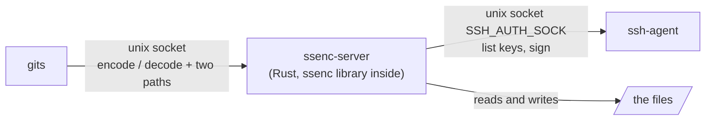
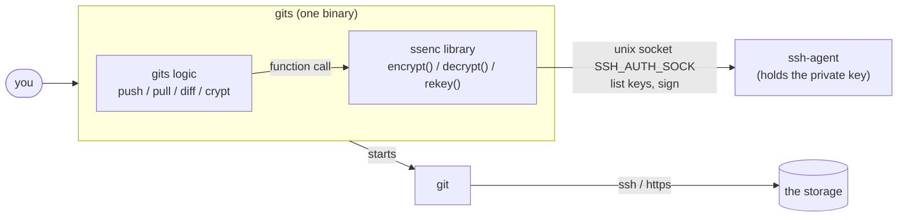
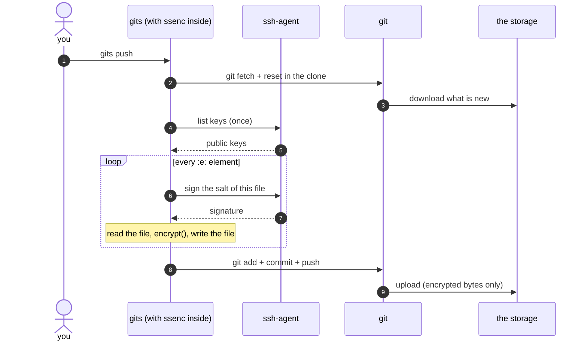

# Do we need `server.ts`? Three ways to get rid of it

[DIAGRAM.md](DIAGRAM.md) shows what takes part in one `gits push` of an encrypted file: gits,
a unix socket, a Node.js server, the `ssenc` binary, another unix socket, ssh-agent. This file
is about the part in the middle: what `server.ts` does, what it needs, and how to remove it.

Nothing here is implemented. It is a description and a plan.

## What `server.ts` does

It is a translator between two things which can't talk to each other directly:

- gits speaks one line of text through a unix socket: `encode "<in>" "<out>"`;
- `ssenc` is a command line program: `ssenc encrypt --ssh-key <key> -i <in> -o <out>`.

For every request the server:

1. reads one line from the socket and splits it into command, input path, output path;
2. picks the arguments for `ssenc` (`encode` -> `encrypt --mode auto`, `decode` -> `decrypt`,
   `rekey` / `rewrap` -> `rekey` with or without `--rewrap-only`);
3. adds the key: `GITS_ENCRYPTION_SSH_KEY` (and `GITS_ENCRYPTION_REKEY_SSH_KEY` for rekey).
   **This is the only place which knows the key.** gits doesn't, and `ssenc` gets it as an argument;
4. starts `ssenc` and waits for it;
5. turns its exit code into the reply: 0 -> `ok ...`, 1 -> `error USAGE`, 2 -> `error AUTH`,
   3 -> `error MALFORMED`, 4 -> `error ENV`;
6. answers the requests of one connection in their order, and writes a line to the log.

It reads no file, encrypts nothing and never talks to the ssh-agent. About 100 of its lines are
the work, the rest is the test client and comments.

## What it needs

| what                                   | why                                                         | who provides it in the demo        |
| -------------------------------------- | ----------------------------------------------------------- | ---------------------------------- |
| Node.js >= 22.18                       | it runs the server                                          | has to be installed                |
| esbuild (`node_modules`)               | `server.ts` -> `server.js`                                  | `npm install`, `encrypt.sh`        |
| the `ssenc` binary                     | does the encryption                                         | `encrypt.sh` copies it to `bin/`   |
| a checkout of the encrypt repository   | the `ssenc` binary comes from it                            | `__linked/STOPSOPA__encrypt`       |
| `start.sh`, `stop.sh`, a pid file      | somebody has to start the server before gits and stop it    | `GITS_START` / `GITS_EXIT`         |
| a place for the socket                 | a path shorter than about 104 characters                    | `tmp/` of the demo                 |
| `SSH_AUTH_SOCK` passed down            | terminal -> gits -> `start.sh` -> server -> `ssenc`         | inherited, breaks when one link drops it |
| 4 variables                            | `GITS_ENCRYPTION_SOCKET`, `GITS_ENCRYPTION_SSH_KEY`, `GITS_DEMO_SSENC`, `GITS_DEMO_LOG` | `env.sh` |

And what it costs at run time, for every gits command: one Node.js process started and
stopped, a test (`server.js test`: 2 more `ssenc` processes), then for every encrypted file one
`ssenc` process and two connections to the ssh-agent.

## Why it exists at all

Because of a decision in gits: *gits never encrypts by itself and knows nothing about the
format*. It only knows the four words of the socket protocol. That gives two real things:

- any encryption can be plugged in ([examples/base64_md5](../base64_md5/ENCRYPT_PROCESS.md) is
  the proof: a different format, no change in gits);
- the gits binary has one dependency (`libc`) and no cryptography in it.

`server.ts` is the price of that decision. The question is whether the price is right for the
case which is used every day: gits + encrypt + ssh-agent.

## Option A: the server rewritten in Rust

The same picture, with the two middle processes merged into one. encrypt is already a library
(`ssenc`, see `rust/src/lib.rs` in its repository): `encrypt()`, `decrypt()`, `rekey()` work on
bytes, `Key::ssh_fingerprint("SHA256:...")` names a key of the agent. So a Rust server does not
start `ssenc`, it calls it.



The natural place for it is the encrypt repository, as a third way to use it next to the
library and the command line: for example `ssenc serve --socket <path> --ssh-key <key>`. gits
does not change at all.

- Gone: Node.js, esbuild, `server.ts`, `encrypt.sh`, one process for every file.
- Stays: a process which somebody starts and stops, the socket, `start.sh`, `stop.sh`, the
  variables, `SSH_AUTH_SOCK` passed down.

It is the smallest change and removes the build tools, but not the thing which makes the setup
hard: a second process which has to be running.

## Option B: gits starts `ssenc` itself

No server and no socket: gits starts the `ssenc` binary for every file, the way the server does
now. One new variable with the command, the key in another.

- Gone: the server, the socket, start and stop, Node.js, esbuild.
- Stays: the `ssenc` binary has to be installed next to gits, one process for every file.
- New in gits: it has to know the arguments of `ssenc` and the meaning of its exit codes. That
  is the same knowledge of encrypt as in option C, without its advantages.

Listed to be complete. Option C does the same job better.

## Option C: one binary, encrypt inside gits

The `ssenc` library becomes a dependency of gits. An encrypted element is then a function call.





One socket is left, the one to the ssh-agent, and that one should stay: it is the reason the
private key never has to be in a file gits can read.

### What disappears

| now                                                         | with option C                                      |
| ----------------------------------------------------------- | -------------------------------------------------- |
| `server.ts`, `server.js`, Node.js, esbuild, `package.json`  | nothing                                            |
| the `ssenc` binary, `encrypt.sh`, a checkout of encrypt     | nothing at run time (cargo fetches it at build time) |
| `start.sh`, `stop.sh`, pid file, `GITS_START` / `GITS_EXIT` | nothing                                            |
| `GITS_ENCRYPTION_SOCKET`, `GITS_DEMO_SSENC`, `GITS_DEMO_LOG` | nothing                                           |
| `SSH_AUTH_SOCK` inherited through 4 processes               | read by gits itself, in the terminal you are in    |
| one process for every file + the test before                | function calls                                     |

The whole setup of this demo becomes one line:

```sh
export GITS_ENCRYPTION_SSH_PUBLIC_KEY"$(ssh-keygen -lf ~/.ssh/gits.pub | cut -d " " -f 2)"
```

and `ssh-add` of that key. Nothing to start, nothing to build.

### What has to be written in gits

The call sites don't change. `src/socket.rs` already hides the encryption behind three
methods which take paths:

```rust
encoder.encode(plain, encrypted)
encoder.decode(encrypted, plain)
encoder.rekey(encrypted, output, rewrap)
```

So the work is a second implementation of those three, which calls the library instead of the
socket, and a choice between the two:

1. **`Cargo.toml`**: an optional dependency and a feature, so the plain build stays as it is.

   ```toml
   [dependencies]
   ssenc = { git = "https://github.com/stopsopa/encrypt", tag = "v0.1.0", optional = true }

   [features]
   ssenc = ["dep:ssenc"]
   ```

2. **A new file, about 100 lines** (`src/embedded.rs`), with the same three methods:
   - `encode`: read the plain file; when the output file exists and starts with `#ssenc1 `,
     pass it as `EncryptOptions.previous` (that is what keeps unchanged lines the same, and
     today this rule lives in `main.rs` of `ssenc`, not in the library, so it has to be
     repeated here or moved to the library); `mode: Auto`; write the result;
   - `decode`: read, `decrypt()`, write;
   - `rekey`: `rekey()` with `RekeyOptions { rotate_data_key: !rewrap }`;
   - the errors: `ssenc::ErrorKind` has the same four kinds the socket protocol has (Usage,
     Auth, Malformed, Env), so they map one to one to the `EncError` gits already uses.
     "Not encrypted, use the file as it is" (`MALFORMED`) keeps working without a change.
3. **Which one is used.** The trait or enum `Encoder` with two forms, picked once at the start:

   | `GITS_ENCRYPTION_SOCKET` | `GITS_ENCRYPTION_SSH_KEY` | what gits does                                   |
   | ------------------------ | ------------------------- | ------------------------------------------------ |
   | defined                  | any                       | the socket, as today (a server of your own wins) |
   | not defined              | defined                   | encrypts itself (only in the build with `ssenc`) |
   | not defined              | not defined               | as today: no encryption available                |

   `GITS_ENCRYPTION_REKEY_SSH_KEY` moves from the server to gits the same way.
4. **`gits crypt status`** can stay as it is (its own check of `#ssenc1` + `#slot`), or use
   `ssenc::inspect()` in the build which has the library.
5. **The build**: `compile.sh`, the release and the install script get a second binary, or the
   build with encryption becomes the only one (see the decisions below).
6. **Tests**: a copy of `tests/test016` / `test018` without the server; the private agent of
   `test018` is reused.

### What it costs

- **Cryptography in the gits binary.** Today gits has one dependency. `ssenc` brings `aes`,
  `ctr`, `hmac`, `sha2`, `argon2`, `subtle`, `zeroize`, `getrandom`. More to compile, a bigger
  binary, and updates of those crates become a reason to release gits. The feature keeps the
  plain build free of it.
- **Rust 1.89** is the minimum for `ssenc`. The build of gits (also in CI and `Cross.toml`) has
  to have it.
- **Two repositories released together.** A fix in the format means a new tag of encrypt and
  then a new release of gits. With the socket they are independent.
- **gits knows the key.** Not the private one (that stays in the agent), but the choice of the
  key and the signature it gets back are in the memory of the gits process. Today they are in
  another process. For a tool which runs for a second on your own machine this is a small
  difference, but it is one.
- **`ssenc` is `publish = false`**, so it is a git dependency: cargo needs network access to
  GitHub at build time, and `Cargo.lock` pins the commit.

### What it gives beyond less setup

- **Speed.** Today every file costs a process and two requests to the agent (find the key,
  sign). In one process there is no process to start, one connection can be kept, and the key
  is looked up once. The signature itself stays one for every file: every encrypted file has
  its own random salt in the `#slot` line and the agent signs that salt, so a signature of one
  file opens nothing else. (A key which wants a touch for every signature wants it for every
  file, with and without the server.)
- **Better errors.** gits gets a typed error with the path, instead of a line of text from
  another process.
- **Several keys** (one file opened by your key and by a backup key): `encrypt()` takes a list
  of keys. `GITS_ENCRYPTION_SSH_KEY` could be a list. The demo server passes only one.
- **Nothing can be "not running"**: the most common error of the current setup is gone.

## Recommendation

Option C, as a feature, and keep the socket.

- The socket protocol is 220 lines in gits which already work and are tested, and
  `examples/base64_md5` depends on it. It stays the way to plug in anything else.
- The encryption inside gits becomes the way for the normal case, with one variable to set.
- Option A is worth doing only if a server is wanted for another reason (for example other
  tools using the same socket). It does not make the setup of gits simpler.

Rough size: one new file of about 100 lines, about 30 lines to choose between the two, the
build and the tests. No change in the logic of push / pull / diff / crypt.

## Decisions before any code

1. **One binary or two?** A build with `ssenc` next to the plain one (two downloads, the user
   chooses), or encryption always inside (one binary, simpler to explain, cryptography in it
   for everybody).
2. **The name of the variable.** `GITS_ENCRYPTION_SSH_KEY` is already used by the demos for the
   server. Using the same name in gits is natural, but a terminal where it is exported (it
   happened in this demo) would switch the encryption on for a gits which had none before.
3. **Both variables defined**: the socket wins (the table above), or an error?
4. **One key or a list** in `GITS_ENCRYPTION_SSH_KEY`?
5. **The `previous` rule**: repeated in gits, or moved into the library of encrypt first, so
   both the command line and gits use the same code?
